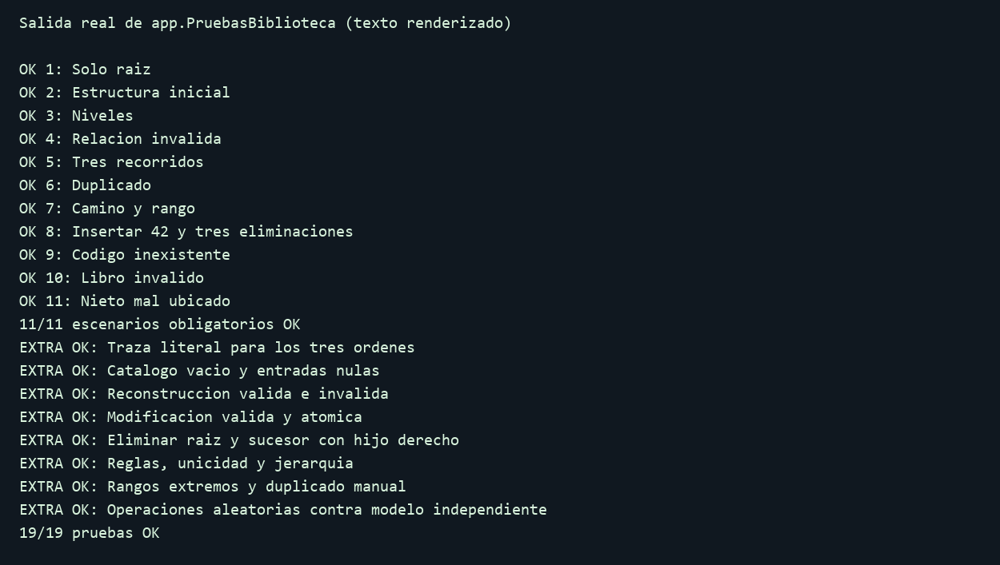

# Deber-Arboles-OtoCristopher
# Catálogo de la Biblioteca FISEI

**Estudiante:** Oto Cristopher. **Proyecto:** `Deber-Arboles-OtoCristopher`.

Aplicación Java de consola que representa la biblioteca mediante un árbol general
`BIBLIOTECA → AREA → ESTANTE`. Cada estante almacena sus libros en un ABB ordenado
por códigos enteros positivos, sin duplicados dentro del mismo catálogo.

## Requisitos y estructura

JDK 8 o posterior, con `java` y `javac` disponibles. No requiere Maven ni librerías externas.

```text
src/
  enums/    TipoUnidad.java, TipoRecorrido.java
  modelo/   Libro.java, UnidadBiblioteca.java
  negocio/  NodoUnidad.java, NodoLibro.java, ArbolBiblioteca.java, CatalogoABB.java
  app/      DatosPrueba.java, PruebasBiblioteca.java, Main.java
docs/       pruebas.png, salida-trazas.txt
README.md
TRAZAS.md
```

Las operaciones de ambos árboles son recursivas, mediante sobrecargas privadas.
La lista de hijos también se recorre recursivamente. Los bucles de `app` controlan
la interfaz, preparan entradas o ejecutan pruebas; no sustituyen las operaciones de los árboles.
Los getters, setters y las validaciones escalares no necesitan recursión artificial.
Se usan listas para almacenar hijos y resultados, sin ordenarlas. No se emplean las
estructuras ni métodos de ordenación prohibidos en la guía.

## Ejecución en Windows / VS Code

Abra **esta carpeta completa** en VS Code y guarde todos los archivos.
Abra una terminal PowerShell en la carpeta que contiene `src` y ejecute:

```powershell
chcp 65001
New-Item -ItemType Directory -Force -Path bin | Out-Null
$fuentesBiblioteca = Get-ChildItem -Path src -Recurse -Filter *.java | Select-Object -ExpandProperty FullName
javac -encoding UTF-8 -d bin $fuentesBiblioteca
java -cp bin app.Main
```

Ejecute `Main`, no una clase del modelo: el punto de entrada es `app.Main.main`.
En VS Code también puede abrir `src/app/Main.java` y ejecutar su método `main`.

Alternativa que compila y detiene la ejecución si hay errores:

```powershell
powershell -NoProfile -ExecutionPolicy Bypass -File .\ejecutar.ps1
```

El permiso anterior se aplica solo al proceso que ejecuta este script; no cambia la política persistente.

## Uso del menú

El programa comienza solo con la raíz. Seleccione `1` y confirme con `s` para cargar
la estructura inicial: 7 unidades, 4 hojas, altura 2 y 13 libros.
Volver a cargar reemplaza los cambios actuales, previa confirmación.

| Opción | Acción |
|---|---|
| 1–2 | Cargar ejemplo / mostrar jerarquía |
| 3–4 | Agregar / buscar unidades |
| 5–6 | Altura, hojas y total de libros / nivel |
| 7–10 | Insertar, buscar, modificar y eliminar libros de un estante |
| 11 | Mostrar los tres recorridos y sus trazas |
| 12 | Rango, camino, validación y reconstrucción desde preorden |
| 0 | Salir |

Los datos viven en memoria; cerrar el programa los descarta.
Los títulos y autores iniciales son ejemplos: la guía solo fija los códigos.
El código de un libro es inmutable; su año debe estar entre 1900 y 2026.
`desdePreorden` construye directamente en O(n), con pila O(h), sin insertar uno por uno.
Al recibir solo códigos, asigna título `Libro X`, autor `Sin especificar` y año `2026`.
Un preorden vacío produce un catálogo vacío; uno inválido provoca una excepción controlada.
La reconstrucción del menú crea un catálogo independiente y muestra sus recorridos.

## Pruebas

Las pruebas se ejecutan por separado mediante su propia clase principal.
El menú de la aplicación contiene las opciones 1–12 y 0 para salir.

Después de compilar:

```powershell
java -cp bin app.PruebasBiblioteca
```

Resultado verificado: **19/19 pruebas OK**. Son 11 escenarios obligatorios y 8 grupos adicionales.
Cada escenario obligatorio incluye las comprobaciones que le corresponden; no se cuentan
como pruebas nuevas las numerosas comprobaciones internas de cada grupo.
Un fallo se imprime y el ejecutable finaliza con error después del resumen.

| Caso obligatorio | Comprobación |
|---|---|
| 1 | Solo raíz: altura 0, una hoja |
| 2 | Inicial: altura 2, cuatro hojas, trece libros |
| 3 | Niveles BIB, sw, SW-E2 y XYZ: 0, 1, 2, -1 |
| 4 | Rechazar ESTANTE bajo BIBLIOTECA |
| 5 | Tres recorridos exactos de SW-E1 |
| 6 | Rechazar código duplicado |
| 7 | Camino de 42 y rango inclusivo 40–75 |
| 8 | Insertar 42 y eliminar 20, 70, 60; preorden final exigido |
| 9 | Buscar, modificar y eliminar un código inexistente |
| 10 | Excepciones por datos de libro inválidos |
| 11 | Detectar nieto que viola el límite de un ancestro |

Los grupos adicionales verifican trazas exactas, entradas nulas, árbol vacío,
reconstrucción, modificación sin cambios parciales, eliminación de raíz, jerarquía,
límites numéricos y 10.000 intentos aleatorios de inserción/eliminación contra un modelo independiente.



La imagen anterior es una representación del [texto obtenido al ejecutar las pruebas](docs/pruebas.txt),
no una captura de la ventana de VS Code. Para la evidencia de entrega exigida por la guía,
ejecute el comando y añada una captura auténtica de su terminal a este README y al PDF.

## Trazas personales

Los dígitos `0262` producen los códigos `2`, `26` y `62`. La resolución paso a paso,
los diagramas Mermaid, los recorridos y las eliminaciones están en [TRAZAS.md](TRAZAS.md).

```powershell
java -cp bin app.Main --trazas
```

Se conserva la [salida real de referencia](docs/salida-trazas.txt).
La demostración elimina consecutivamente 2 (hoja), 45 (un hijo) y 60 (dos hijos).
Este ejemplo es independiente del caso obligatorio que inserta 42 y elimina 20, 70 y 60.

También puede comprobarlo manualmente desde el menú: cargue el ejemplo con `1`,
inserte en `SW-E1` los códigos `2`, `26` y `62` mediante `7`, y consulte los recorridos
con `11`. Luego elimine `2`, `45` y `60` mediante `10`, consultando `11` después de
cada eliminación. Dibuje los árboles resultantes en Mermaid dentro de `TRAZAS.md`.
El menú no incluye una opción especial para los códigos personales; `--trazas`
se conserva como herramienta opcional de comprobación desde la terminal.

## Estado de la entrega

Código, pruebas y trazas implementados y comprobados. Este paquete no acredita la creación
de un repositorio público, tres commits, el merge de `desarrollo` a `main` mediante PR,
ni la entrega en Moodle. Esas acciones y el PDF con evidencias auténticas deben completarse
antes del 22 de octubre de 2026 a las 07:00, según la guía.
Revise y comprenda la derivación de TRAZAS.md: el enunciado solicita resolverla a mano.
