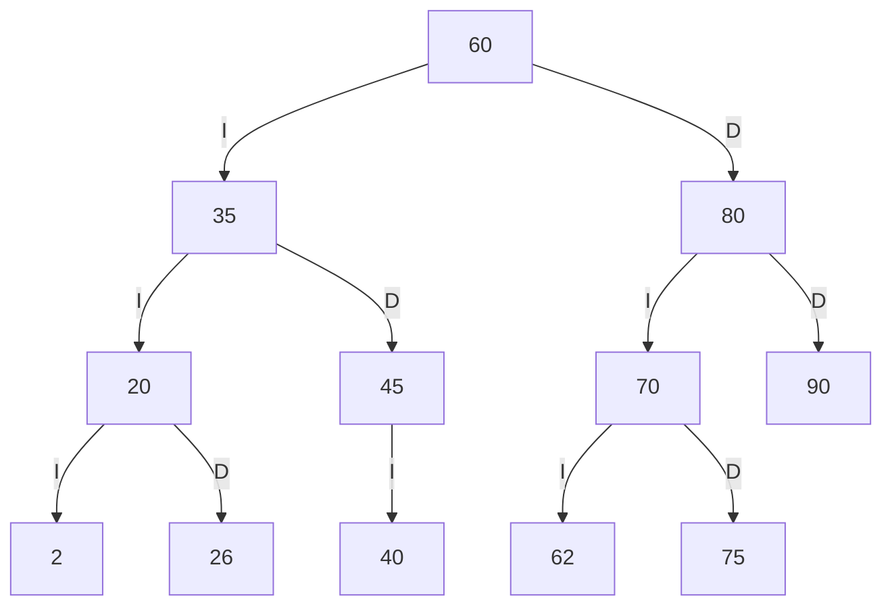
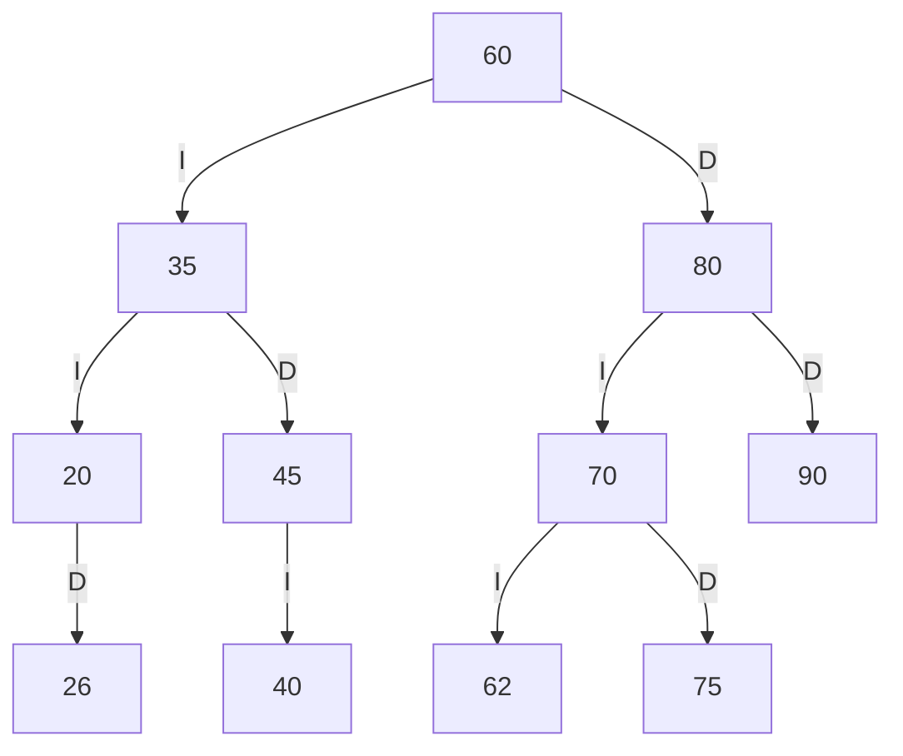
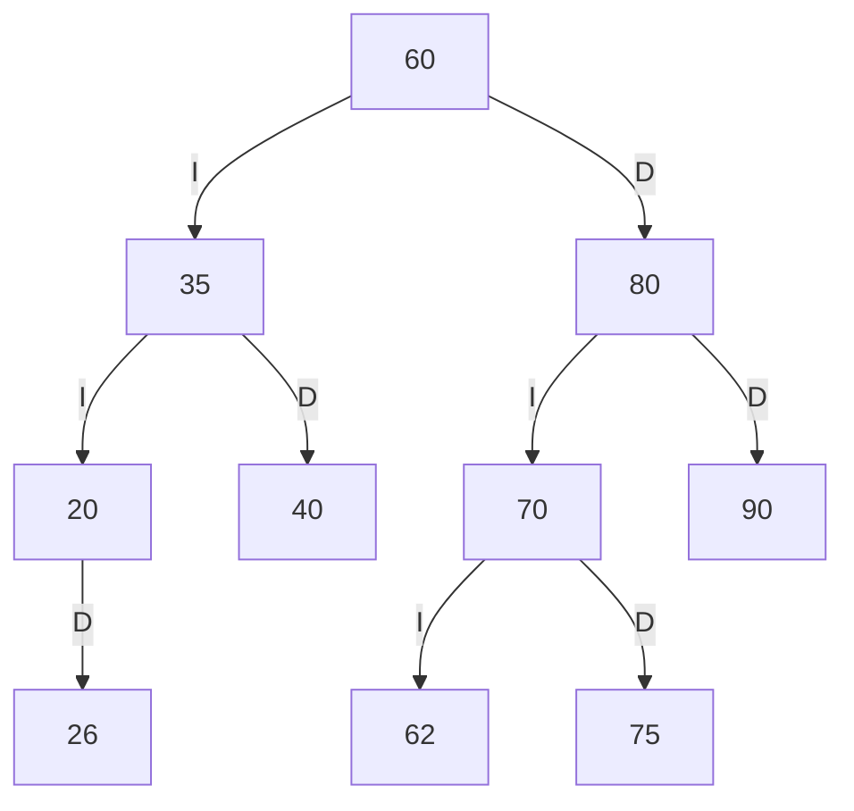
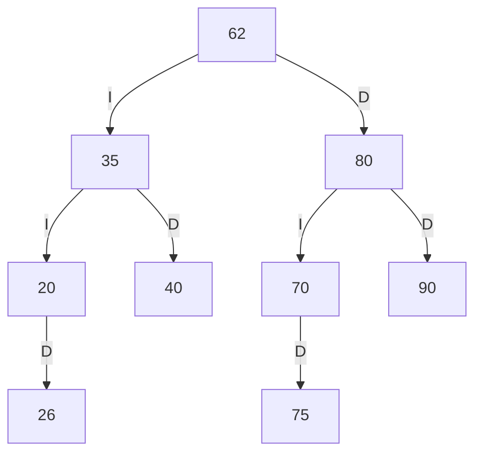

# TRAZAS — Oto Cristopher

## 1. Códigos personales

Últimos cuatro dígitos: **0262**. Por tanto a=0, b=2, c=6 y d=2.

| Par | Valor entero | Ajuste | Código final |
|---|---:|---|---:|
| ab = 02 | 2 | Positivo, no repetido ni existente | 2 |
| bc = 26 | 26 | Positivo, no repetido ni existente | 26 |
| cd = 62 | 62 | Positivo, no repetido ni existente | 62 |

El cero inicial de `02` no convierte el número en cero: su valor es 2.
Si hubiera un conflicto se incrementaría hasta obtener un código positivo y libre.

Orden de inserción: `60 35 80 20 45 70 90 40 75`, seguido de `2 26 62`.
No se agrega 42: ese código pertenece a otro caso de prueba obligatorio.

## 2. Derivación paso a paso

| Código | Comparaciones y ubicación |
|---:|---|
| 60 | Raíz |
| 35 | 35 < 60: hijo I de 60 |
| 80 | 80 > 60: hijo D de 60 |
| 20 | 20 < 60, 20 < 35: hijo I de 35 |
| 45 | 45 < 60, 45 > 35: hijo D de 35 |
| 70 | 70 > 60, 70 < 80: hijo I de 80 |
| 90 | 90 > 60, 90 > 80: hijo D de 80 |
| 40 | 40 < 60, 40 > 35, 40 < 45: hijo I de 45 |
| 75 | 75 > 60, 75 < 80, 75 > 70: hijo D de 70 |
| 2 | 2 < 60, 2 < 35, 2 < 20: hijo I de 20 |
| 26 | 26 < 60, 26 < 35, 26 > 20: hijo D de 20 |
| 62 | 62 > 60, 62 < 80, 62 < 70: hijo I de 70 |

Esta derivación permite comprobar los resultados sin ejecutar el algoritmo.
I representa hijo izquierdo y D hijo derecho; los hijos vacíos se omiten del diagrama.



## 3. Recorridos esperados

- Preorden (raíz, izquierdo, derecho): `60 35 20 2 26 45 40 80 70 62 75 90`.
- Inorden (izquierdo, raíz, derecho): `2 20 26 35 40 45 60 62 70 75 80 90`.
- Posorden (izquierdo, derecho, raíz): `2 26 20 40 45 35 62 75 70 90 80 60`.

## 4. Traza preorden

Se entra y visita cada nodo antes de recorrer sus hijos. Cada hijo vacío también genera una línea.
Hay 12 nodos, 13 hijos nulos y una línea final: 12 + 12 + 13 + 1 = **38 líneas**.

```text
entra 60
VISITA 60
  entra 35
  VISITA 35
    entra 20
    VISITA 20
      entra 2
      VISITA 2
        null -> regresa
        null -> regresa
      entra 26
      VISITA 26
        null -> regresa
        null -> regresa
    entra 45
    VISITA 45
      entra 40
      VISITA 40
        null -> regresa
        null -> regresa
      null -> regresa
  entra 80
  VISITA 80
    entra 70
    VISITA 70
      entra 62
      VISITA 62
        null -> regresa
        null -> regresa
      entra 75
      VISITA 75
        null -> regresa
        null -> regresa
    entra 90
    VISITA 90
      null -> regresa
      null -> regresa
Secuencia PREORDEN: 60 35 20 2 26 45 40 80 70 62 75 90
```

## 5. Eliminaciones consecutivas

Se parte del árbol personalizado anterior y se conserva el resultado de cada eliminación.

### 5.1. Hoja: eliminar 2

El 2 no tiene hijos. El enlace izquierdo del 20 queda vacío. Restan 11 libros.
Preorden esperado: `60 35 20 26 45 40 80 70 62 75 90`.



### 5.2. Un hijo: eliminar 45

El 45 solo tiene el hijo izquierdo 40. El enlace derecho del 35 pasa a apuntar al 40. Restan 10 libros.
Preorden esperado: `60 35 20 26 40 80 70 62 75 90`.



### 5.3. Dos hijos: eliminar 60

El 60 tiene hijos 35 y 80. Su sucesor inorden es el mínimo del subárbol derecho:
80 → 70 → 62. Se reemplaza el libro de la raíz por el libro 62 y se elimina el nodo 62 original,
dejando vacío el enlace izquierdo del 70. Restan 9 libros.
Preorden esperado: `62 35 20 26 40 80 70 75 90`.



## 6. Comparación con la ejecución real

Se ejecutó `java -cp bin app.Main --trazas`. La salida completa se conserva en
[docs/salida-trazas.txt](docs/salida-trazas.txt), incluidos los cuatro diagramas.

| Punto | Resultado esperado | Salida del programa | Coincide |
|---|---|---|---|
| Códigos | 2 26 62 | 2 26 62 | Sí |
| Preorden | 60 35 20 2 26 45 40 80 70 62 75 90 | 60 35 20 2 26 45 40 80 70 62 75 90 | Sí |
| Inorden | 2 20 26 35 40 45 60 62 70 75 80 90 | 2 20 26 35 40 45 60 62 70 75 80 90 | Sí |
| Posorden | 2 26 20 40 45 35 62 75 70 90 80 60 | 2 26 20 40 45 35 62 75 70 90 80 60 | Sí |
| Traza preorden | 38 líneas, contenido del apartado 4 | 38 líneas idénticas | Sí |
| Eliminar 2 | 60 35 20 26 45 40 80 70 62 75 90 | 60 35 20 26 45 40 80 70 62 75 90 | Sí |
| Eliminar 45 | 60 35 20 26 40 80 70 62 75 90 | 60 35 20 26 40 80 70 62 75 90 | Sí |
| Eliminar 60 | 62 35 20 26 40 80 70 75 90 | 62 35 20 26 40 80 70 75 90 | Sí |
| Validez tras cada eliminación | true / true / true | true / true / true | Sí |

